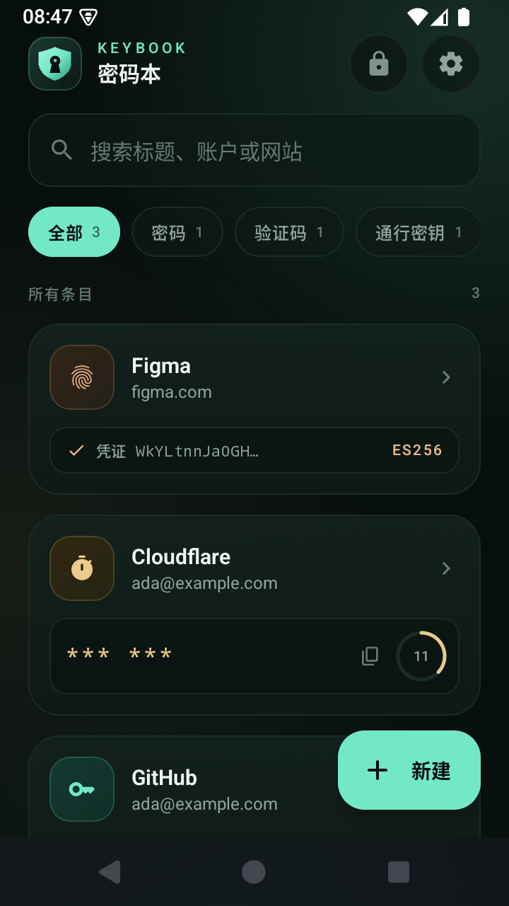
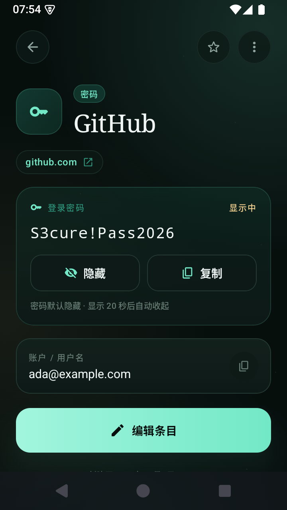
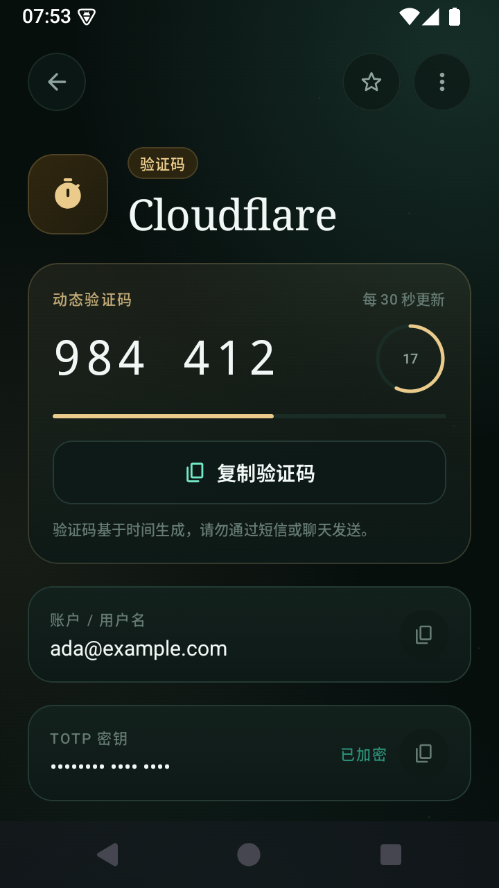
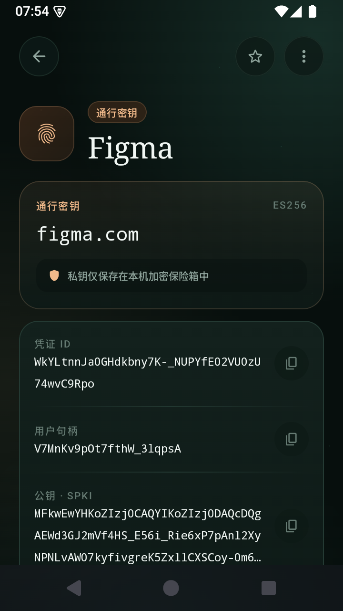
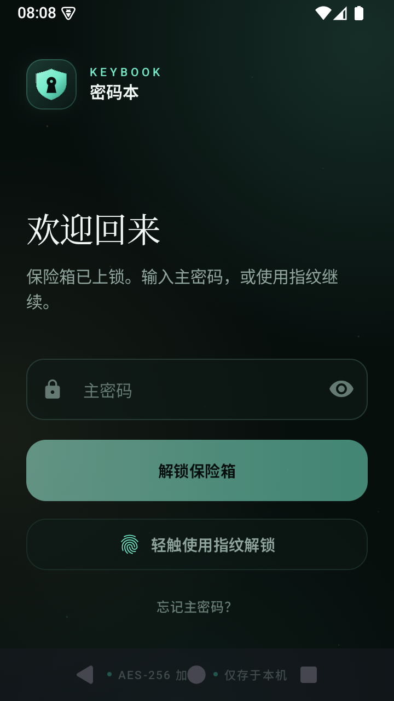
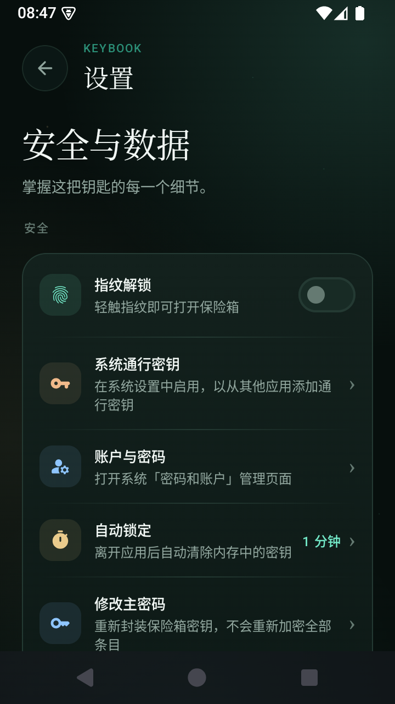
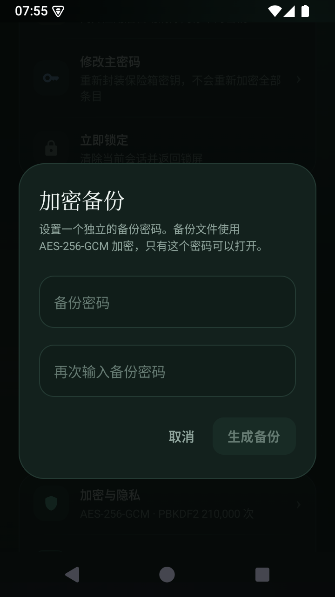
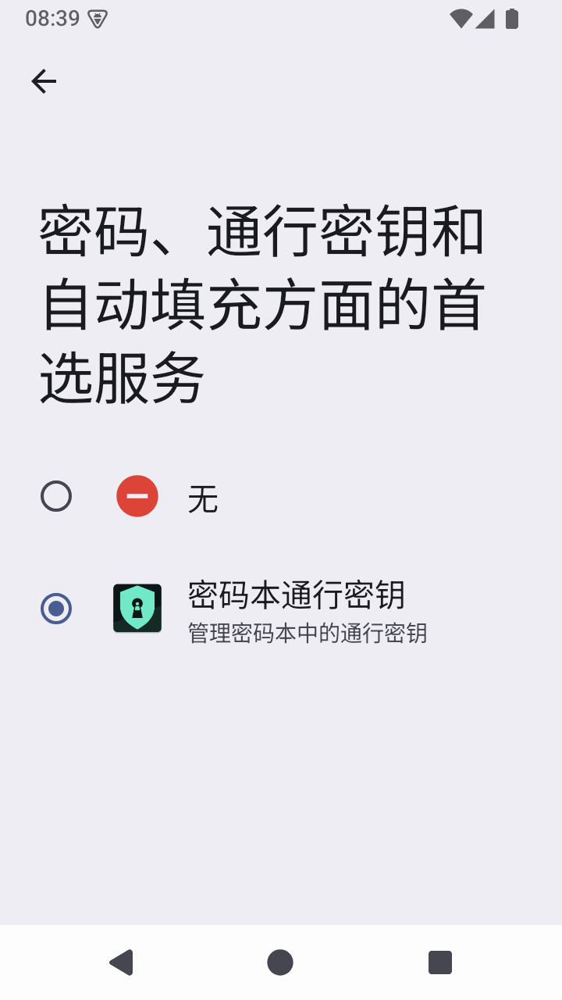
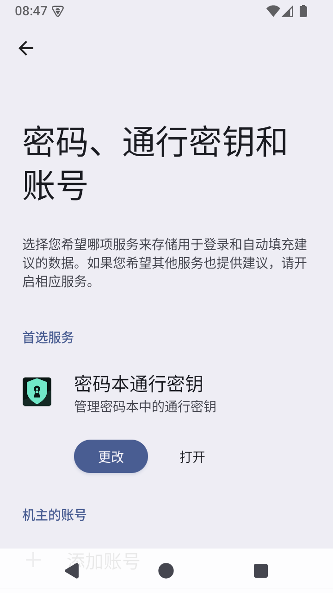

# 密码本 · Keybook

一个完全离线的 Android 密码保险箱，用来保存登录密码、TOTP 动态验证码与通行密钥；同时可作为 Android 系统 Credential Manager 的通行密钥提供方。

  

## 1.1.0 更新

- 首页移除日期、欢迎标题和加密状态大卡片，搜索框直接位于标题栏下方，为账号列表腾出更多空间。
- 首页验证码默认显示为 `*** ***`，旁边保留复制按钮；详情页仍显示实时数字与倒计时。
- 注册为 Android Credential Manager 通行密钥提供方，支持从其他应用创建/使用通行密钥。
- 设置页新增「系统通行密钥」和「账户与密码」入口，后者直接打开系统 `AccountDashboardActivity`。

## 截图

| 保险箱 | 密码详情（点击显示） |
| --- | --- |
|  |  |
| **动态验证码** | **通行密钥** |
|  |  |
| **应用锁屏** | **安全设置** |
|  |  |
| **指纹验证** | **加密备份** |
|  |  |
| **系统通行密钥提供方** | **账户与密码入口** |
|  |  |

## 已实现功能

- **文本密码**：标题、账户、密码、网站、备注、收藏；密码默认隐藏，点按眼睛图标显示，20 秒后自动收起。
- **TOTP 动态验证码**：兼容标准 `otpauth://` 链接和 Base32 密钥，支持 SHA1 / SHA256 / SHA512、6 / 8 位、30 / 60 秒周期，列表与详情实时倒计时；列表中验证码默认显示为 `*** ***`，可点按复制，详情页查看具体数字。
- **通行密钥库**：保存 RP ID、账户、凭证 ID、用户句柄、SPKI 公钥和 PKCS#8 私钥；可在本机生成 ES256（P-256）通行密钥材料。
- **系统通行密钥提供方**：Android 14+ 可注册为 Credential Manager 的通行密钥提供方。其他应用创建或使用通行密钥时，会打开密码本进行解锁与确认；私钥始终留在加密保险箱内，签名在本机完成。
- **应用锁定**：主密码解锁；离开应用后按「立即 / 15 秒 / 1 分钟 / 5 分钟」自动锁定，锁定即清除内存中的密钥与明文。
- **指纹解锁**：使用 Android Keystore 中的 AES 密钥封装随机保险箱密钥，必须通过强生物识别才能解密；新增指纹会让旧封装自动失效。
- **加密存储**：AES-256-GCM 加密整个条目库；主密码通过 PBKDF2-HMAC-SHA256（210,000 次迭代）派生密钥。
- **加密备份与恢复**：导出独立密码保护的 `.keybook` 二进制备份；恢复前解密预览条目数，并明确确认覆盖。
- **系统设置入口**：设置页提供「账户与密码」「系统通行密钥」入口，可直接进入 Android 的 `AccountDashboardActivity` 或通行密钥服务选择页。
- **安全细节**：无网络权限、禁用 Android 自动备份、正式版禁止截屏与最近任务预览、剪贴板 60 秒自动清空、密码生成器、搜索与分类、收藏。

## 安全设计

```
主密码 ──PBKDF2-HMAC-SHA256(210k, salt)──► KEK
                                            │
随机 256-bit 保险箱密钥 (VMK) ◄── AES-256-GCM 解封 ──┘
        │
        ├── AES-256-GCM 加密 vault.bin（所有条目）
        └── 指纹：Android Keystore AES 密钥封装 VMK（需 BIOMETRIC_STRONG）
```

- 条目库始终以密文写入应用私有目录；保险箱密钥、主密码明文不会落盘。
- 修改主密码只重新封装 VMK，不重写全部密文。
- 备份使用独立盐、随机 nonce 与独立备份密码，AES-256-GCM 提供完整性校验。
- 指纹封装与 Keystore 绑定；生物识别变更或设备重置后自动退回主密码。
- `allowBackup=false`，并通过 `dataExtractionRules` 排除所有域。

## 构建

环境要求：JDK 17+、Android SDK Platform 35、Build Tools 35。

```bash
# Windows
gradlew.bat :app:assembleDebug
# macOS / Linux
./gradlew :app:assembleDebug
```

APK 输出：`app/build/outputs/apk/debug/app-debug.apk`

发布版（R8 混淆 + 资源压缩）：

```bash
gradlew.bat :app:assembleRelease
```

生成未签名 APK 后，用 `apksigner` 与自己的发布密钥签名即可侧载安装。

本次构建的已签名安装包：`dist/Keybook-1.1.0.apk`（SHA-256 见同目录校验文件）。

运行单元测试：

```bash
gradlew.bat :app:testDebugUnitTest
```

## 项目结构

```
app/src/main/java/com/keybook/vault/
├── data/          # 数据模型、设置、VaultRepository（会话与自动锁定）
├── security/      # VaultCrypto、文件格式、Android Keystore 指纹封装、通行密钥生成
├── passkeys/      # Credential Manager 提供方、WebAuthn 证明/断言、CBOR
├── totp/          # Base32、HMAC、otpauth 解析
├── ui/            # Compose 主题、组件、页面、ViewModel
└── util/          # 密码生成器、格式化、剪贴板
```

## 启用系统通行密钥

1. 安装后打开应用，确认至少设置过主密码。
2. 进入「设置 → 账户与密码」，打开系统「密码、通行密钥和账号」页面。
3. 在「首选服务」中点击「更改」，选择「密码本通行密钥」。
4. 之后在支持 Credential Manager 的应用中创建或使用通行密钥，会打开密码本进行解锁和确认。

## 说明

- 通行密钥提供方实现标准 WebAuthn ES256 “none” attestation，支持创建与断言签名；适用于 Android 14+ Credential Manager。私钥只保存在加密保险箱中。
- 主密码与备份密码无法找回。请单独保管加密备份和备份密码。
- 本项目为本地单机应用，不包含云同步或账户系统。
- WebAuthn/CBOR 响应结构参考 Android 官方 Credential Provider 示例（Apache-2.0）：https://github.com/android/identity-samples

## 已验证

- 14 个 JVM 单元测试通过（RFC 6238 SHA1/SHA256/SHA512 向量、Base32、otpauth 解析、备份加解密与篡改检测、WebAuthn 证明/断言与 ECDSA 验签）。
- 在 Android 15（API 35）模拟器上实测：创建保险箱、密码/TOTP/通行密钥创建与读取、密码与验证码默认隐藏、错误主密码提示、立即自动锁定、指纹录入与指纹解锁、AES 备份导出、备份恢复覆盖。
- 使用独立的测试客户端应用，从另一个应用经 Credential Manager 成功创建通行密钥并完成断言登录；服务端收到的 ECDSA 签名已用创建时的公钥验证通过。
- 发布版禁止截屏与最近任务预览；调试版为便于开发保留截图能力。
